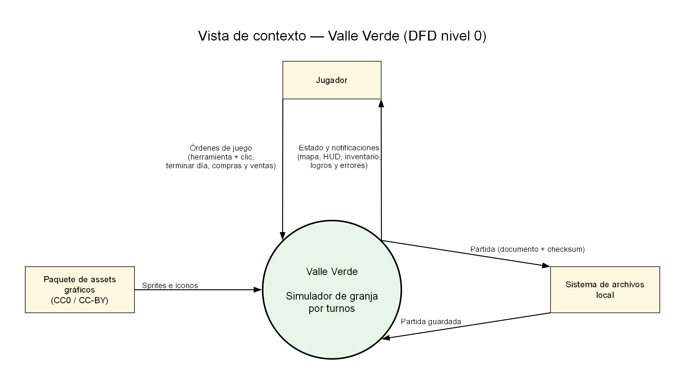
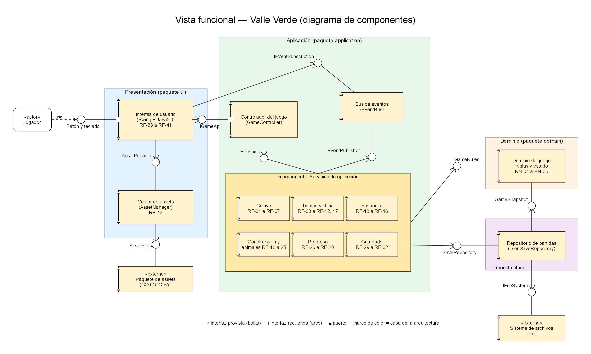
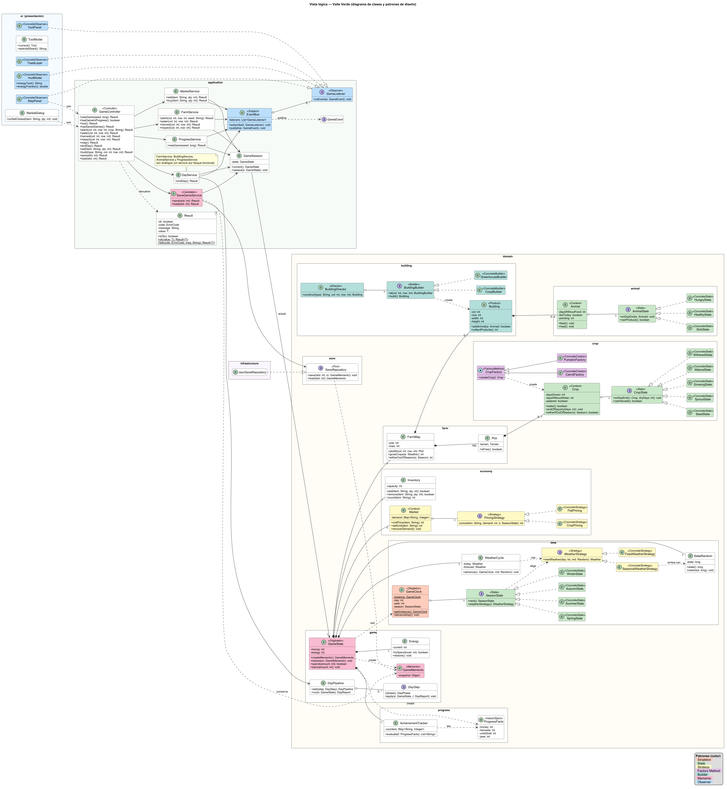
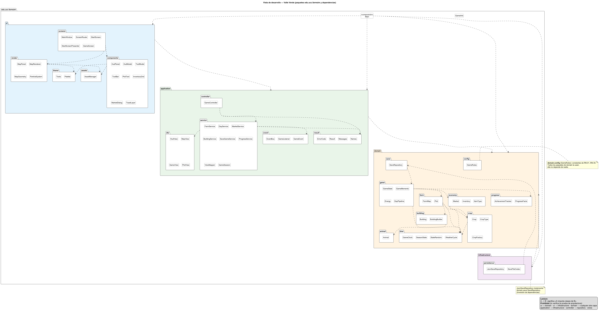
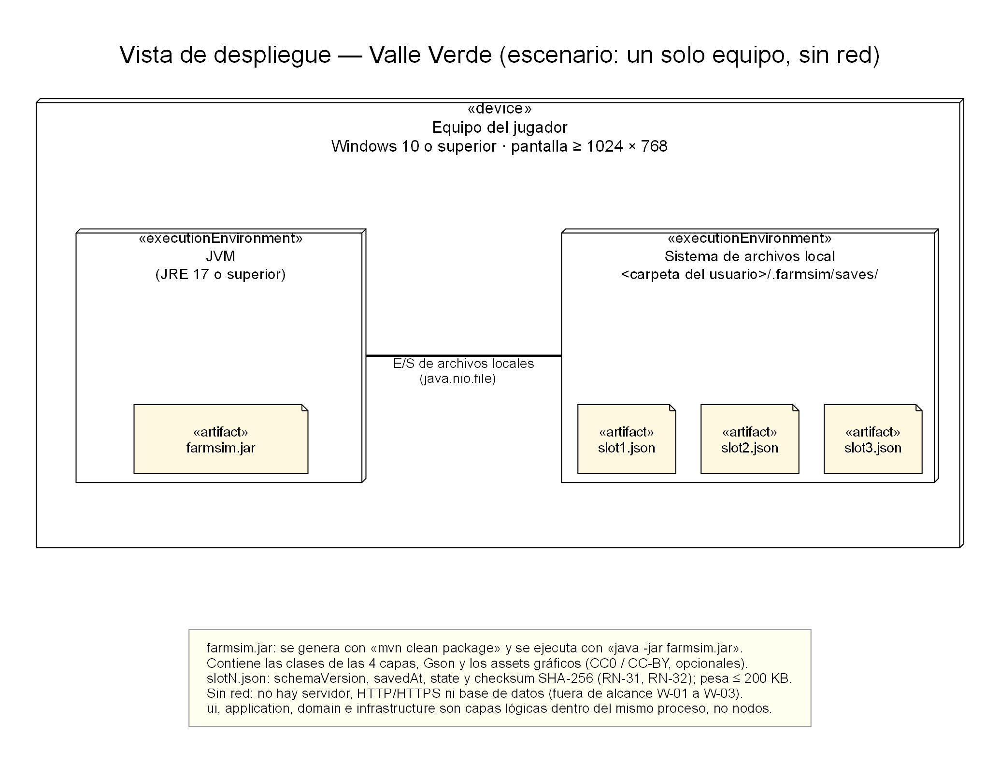
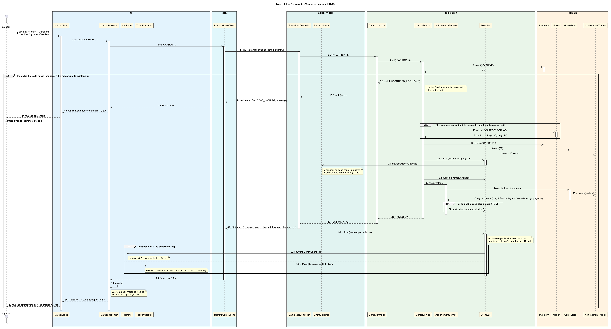

# Diagramas — Valle Verde

> **Versión 0.1 · 2026-11-22 · Fase 3**
> Las **5 vistas** que exige la plantilla del profesor (`docs/entrada/Modelo de presentación de diseño.pptx`, diapositivas 2 a 6) y **1 secuencia anexa**. Los archivos fuente son PlantUML (`.puml`) y se renderizan a PNG con `tools/render_diagrams.sh`. El verificador `tools/check_diagrams.py` comprueba la coherencia entre los diagramas (ver §8).

| # | Diapositiva | Vista | Notación | Archivo | Responde |
|---|---|---|---|---|---|
| 1 | 2 | Contexto | DFD nivel 0 | [01_vista_contexto](diagramas/01_vista_contexto.puml) · [PNG](diagramas/01_vista_contexto.png) | ¿Con quién se relaciona el sistema y qué intercambian? |
| 2 | 3 | Funcional | Componentes UML | [02_vista_funcional](diagramas/02_vista_funcional.puml) · [PNG](diagramas/02_vista_funcional.png) | ¿Qué bloques funcionales hay y qué servicios se ofrecen? |
| 3 | 4 | Lógica | Clases UML + patrones | [03_vista_logica](diagramas/03_vista_logica.puml) · [PNG](diagramas/03_vista_logica.png) | ¿Qué objetos existen y cómo se relacionan? |
| 4 | 5 | Desarrollo | Paquetes y dependencias | [04_vista_desarrollo](diagramas/04_vista_desarrollo.puml) · [PNG](diagramas/04_vista_desarrollo.png) | ¿Cómo está organizado el código y de qué depende cada parte? |
| 5 | 6 | Despliegue | Despliegue UML | [05_vista_despliegue](diagramas/05_vista_despliegue.puml) · [PNG](diagramas/05_vista_despliegue.png) | ¿Dónde se ejecuta el software y cómo se conectan los nodos? |
| A1 | anexo | Secuencia «Vender cosecha» | Secuencia UML | [A1_secuencia_vender_cosecha](diagramas/A1_secuencia_vender_cosecha.puml) · [PNG](diagramas/A1_secuencia_vender_cosecha.png) | ¿En qué orden colaboran los participantes en un caso de uso? |

> **Estado:** estos diagramas son la **propuesta de diseño** que la Fase 4 (arquitectura) formalizará. Si la Fase 4 cambia algo, los diagramas se actualizan en el mismo commit.

---

## 1. Vista de contexto

- **Cubre:** alcance y actores de [`VISION_ALCANCE.md`](VISION_ALCANCE.md) §4–5; CU-14, CU-15 y CU-18 (actores secundarios).
- **Contenido:** un solo círculo (el sistema, sin nada dentro), 3 entidades externas (**Jugador**, **Sistema de archivos local**, **Paquete de assets gráficos**) y 5 flujos con sustantivo: *Órdenes de juego*, *Estado y notificaciones*, *Partida (JSON + checksum)*, *Partida guardada* y *Sprites e iconos*.
- **Decisiones:** el reloj del juego no es entidad externa (avanza solo cuando el jugador termina el día); el almacén de datos no aparece (la guía lo reserva para niveles internos del DFD); no hay flechas entre entidades externas.
- **Nota de notación:** el contexto no es UML formal sino un DFD nivel 0, como la plantilla («Online Community»). Se dibuja en un bloque `@startdot` dentro del `.puml` para obtener un círculo real.

## 2. Vista funcional

- **Cubre:** los **42 RF** agrupados por componente (el verificador confirma que cada RF aparece **exactamente una vez**), HU-10, HU-29, HU-30, HU-35, HU-42 y las RN-01 a RN-35 (en el dominio).
- **Componentes:** Interfaz de usuario (RF-33 a RF-41), Gestor de assets (RF-42), Controlador del juego, Servicios de aplicación (6 bloques: cultivo RF-01–07, tiempo y clima RF-08–12 y RF-17, economía RF-13–16, construcción y animales RF-18–25, progreso RF-26–28, guardado RF-29–32), Bus de eventos, Dominio del juego, Repositorio de partidas y dos externos (sistema de archivos y paquete de assets).
- **Interfaces:** `IGameApi`, `IServicios`, `IGameRules`, `IEventPublisher`, `IEventSubscription`, `IAssetProvider`, `ISaveRepository`, `IGameSnapshot`, `IFileSystem` e `IAssetFiles`; más 2 puertos en los componentes de entrada.
- **Decisiones:**
  - La interfaz `ISaveRepository` la define el **dominio** y la implementa la infraestructura (inversión de dependencias); el repositorio requiere `IGameSnapshot` del dominio.
  - RF-17 (resumen del día) está en *Tiempo y clima* porque lo produce `DayService` al terminar el día, aunque su épica sea Economía; RF-28 (nueva partida) está en *Progreso* porque crea el estado inicial y los logros.
  - Se omiten las interfaces de cada servicio individual: se muestran agrupadas como `IServicios` para que el diagrama sea legible.

## 3. Vista lógica

- **Cubre:** modelo de dominio y capa de aplicación para RF-01 a RF-32; HU-01 a HU-32.
- **Contenido:** 53 clases en 4 paquetes (`ui`, `application`, `domain` con 9 subpaquetes e `infrastructure`). Cada clase de patrón lleva su **estereotipo** y su **color**; la leyenda enumera los 7 colores.
- **Relaciones (justificadas, sin rombos de adorno):**
  - **Composición (◆)** donde la parte no existe sin el todo: `GameState` → `FarmMap`, `Inventory`, `Market`, `AchievementTracker`; `FarmMap` → 160 `Plot` y → `Building`; `Plot` → `Crop` (0..1); `Building` → `Animal` (0..4).
  - **Agregación (◇)** donde la parte tiene ciclo de vida independiente: un estado o una estrategia es compartible y reemplazable (`Crop` → `CropState`, `Animal` → `AnimalState`, `GameClock` → `SeasonState`, `Market` → `PricingStrategy`), `EventBus` → `GameListener` y `BuildingDirector` → `BuildingBuilder`.
  - **Dependencia (- - ->)** para uso puntual sin referencia mantenida (`GameState` → `GameClock`, `SeasonState` → `WeatherStrategy`, `MapPanel` → `GameController`).
- **Se muestra un subconjunto representativo:** de las 5 fábricas de cultivo solo `CarrotFactory` y `PumpkinFactory`; de las 4 construcciones solo `CoopBuilder` y `GreenhouseBuilder`; los servicios `FarmService`, `BuildingService`, `AnimalService` y `ProgressService` se indican en una nota. No se dibujan los enumerados (`Terrain`, `Weather`, `CropType`, `AnimalType`, `BuildingType`, `ItemType`), que aparecen como tipos de atributos.

### 3.1 Patrones de diseño aplicados y su justificación

| Patrón | Rol → clases | Historias | Por qué se aplica (y no «por adorno») |
|---|---|---|---|
| **Singleton** | `GameClock` | HU-09 | Hay un único calendario por partida y varios servicios lo consultan. *Riesgo:* el estado global estorba a las pruebas; *mitigación:* `GameClock` expone un método para restaurar su fecha (lo usa el *Memento* al cargar) y las pruebas lo reinician |
| **State** | Contexto `Crop` → `CropState` (`SeedState`, `SproutState`, `GrowingState`, `MatureState`, `WitheredState`); `Animal` → `AnimalState` (`HealthyState`, `HungryState`, `SickState`); `GameClock` → `SeasonState` (4 estaciones) | HU-03, HU-05, HU-09, HU-21 | El comportamiento cambia con el estado (un cultivo marchito no crece, un animal enfermo no produce) y las transiciones están en RN-08, RN-09 y RN-25; evita cadenas de `if` repartidas por el código |
| **Strategy** | `WeatherStrategy` (`SeasonalWeatherStrategy`, `FixedWeatherStrategy`) y `PricingStrategy` (`CropPricing`, `FlatPricing`) | HU-11, HU-15 | El clima y el precio son algoritmos intercambiables: el día 1 y las pruebas usan clima fijo (RN-13); las cosechas tienen factor de temporada (RN-17) y los productos animales no |
| **Factory Method** | Creador `CropFactory` → `CarrotFactory`, `PumpkinFactory` (y 3 más) | HU-01 | Cada cultivo se crea con sus propios valores (RN-05); sembrar solo conoce `CropFactory`, así que un cultivo nuevo no obliga a tocar `FarmService` |
| **Builder** | `BuildingBuilder` (`CoopBuilder`, `GreenhouseBuilder`…) + `BuildingDirector` | HU-18 | Un edificio tiene muchos parámetros (tipo, posición, tamaño, capacidad, costo) y validaciones de colocación (RN-20, RN-21); se construye paso a paso y se valida al final |
| **Memento** | Originador `GameState`; recuerdo `GameMemento`; cuidador `SaveGameService` | HU-29, HU-30, HU-31 | Guardar y cargar requieren una instantánea inmutable que no exponga el estado interno; así «cargar un archivo inválido sin alterar la partida» es natural (se construye aparte y solo reemplaza al actual si todo es válido, RN-33) |
| **Observer** | Sujeto `EventBus`; observador `GameListener`; concretos `HudPanel`, `MapPanel`, `ToastLayer` | HU-34, HU-35, HU-39 | La UI debe actualizarse por eventos y no consultando en bucle (R-04); el bus desacopla `application` de `ui` |

Cada clase que implemente un patrón llevará el Javadoc `Pattern: <nombre> — Role: <rol>` (RNF-13).

## 4. Vista de desarrollo

- **Cubre:** RNF-06 (sentido de las dependencias), RNF-12, R-02 y la estructura de paquetes en la que se escribirán las HU-01 a HU-42.
- **Contenido:** el paquete raíz `edu.ucc.farmsim` con `Main` (raíz de composición) y 4 capas: `ui` (screens, components, render, assets, theme), `application` (controller, service, event, dto, result), `domain` (game, save, farm, crop, building, animal, economy, time, progress, config) e `infrastructure` (persistence).
- **Cómo se lee:** la flecha punteada `A ..> B` significa «A importa clases de B» y apunta a quien se usa.
- **Reglas verificadas visualmente:** `ui → application → domain`; `infrastructure → domain` (la flecha sube hacia el dominio); `domain` no depende de ninguna otra capa; no hay ciclos; el controlador solo conoce los servicios (nunca el repositorio); la UI no importa `domain` ni `infrastructure`.
- **Dentro de `domain`:** `game` → `farm`, `economy`, `time`, `progress`; `farm` → `crop`, `building`; `building` → `animal`; `crop` y `economy` → `time`; `economy` → `crop`; `save` → `game`. `config` (constantes de las RN) la usan todos y no depende de nadie (se indica con una nota para no saturar el diagrama).
- **Pendiente para la Fase 5:** una prueba de arquitectura automática comprobará los `import` reales contra este diagrama.

## 5. Vista de despliegue

- **Cubre:** RNF-02, RNF-03, RNF-11, R-07, W-01 a W-03; HU-29, HU-30 y HU-33; RN-31 y RN-32.
- **Contenido:** un nodo `«device»` (el equipo del jugador, Windows 10 o superior), dos entornos de ejecución `«executionEnvironment»` (la **JVM** con JRE 17+ y el **sistema de archivos local** en `<carpeta del usuario>/.farmsim/saves/`), el artefacto `farmsim.jar` y los artefactos `slot1.json`, `slot2.json` y `slot3.json`. Una ruta de comunicación: **E/S de archivos locales (`java.nio.file`)**.
- **Decisiones (según el PDF de despliegue, p. 14 y p. 17):** no se dibujan las capas como servidores (son agrupaciones lógicas dentro del mismo proceso); no se confunde una clase con un artefacto; no se agrega red, servidor ni base de datos porque el escenario no los tiene (fuera de alcance W-01 a W-03).

## 6. Anexo A1 · Secuencia «Vender cosecha»

- **Cubre:** HU-15 (CA-1 y CA-6), HU-26 (LG-04), HU-34, HU-38 y HU-39; RF-15, RF-26, RF-34, RF-38 y RF-39; RN-14, RN-15, RN-17, RN-18 y RN-28.
- **Camino exitoso:** 3 Zanahorias en Primavera con demanda 100 → `sellUnit` ×3 (27 + 26 + 26) → `remove` → `earn(79)` → `evaluate` → `publish(SaleCompleted)` → `onEvent` en `HudPanel` y `ToastLayer` → `Result.ok(79)`.
- **Camino de error:** cantidad fuera de rango → `Result.fail(CANTIDAD_INVALIDA)` sin modificar inventario, saldo ni demanda.
- **Regla del taller:** cada mensaje sólido corresponde a una operación del diagrama de clases (verificado por script).
- **Demuestra la regla de capas:** `MarketDialog` → `GameController` → `MarketService` → dominio; el controlador nunca llama a un repositorio y la UI recibe solo un `Result` (nunca una excepción).

## 7. Notación: errores de la plantilla que NO se replicaron

Tomados de la revisión de la guía de estudio y del PDF de despliegue:

| En la plantilla | En estos diagramas |
|---|---|
| Ruta `https:80` (HTTPS en el puerto de HTTP) | No hay red; la única ruta lleva protocolo coherente (E/S de archivos locales) |
| El navegador como «device» | La JVM y el sistema de archivos son `«executionEnvironment»`; solo el equipo es `«device»` |
| Nombres con `:` (instancias) | Nombres simples de nodos y artefactos |
| Multiplicidad `1,2` y atributos públicos `+` | Multiplicidades con `..` (`0..4`, `0..1`) y atributos privados `-` |
| Subclases que repiten atributos heredados | Las subclases de patrón no repiten lo heredado |
| Desarrollo dibujado con clases | Desarrollo dibujado con **paquetes** y dependencias punteadas (la guía recomienda paquetes) |
| Agregación sin justificar | Cada rombo está justificado en §3 (ciclo de vida) |

## 8. Coherencia y verificación

`python tools/check_diagrams.py` comprueba, y debe terminar con `SIN ERRORES`:

| Comprobación | Resultado actual |
|---|---|
| Las clases comunes a la vista lógica y a la de desarrollo están en el **mismo paquete** | 28 clases comunes, 0 discrepancias |
| Cada **mensaje** de la secuencia es una operación de la clase receptora (o de la interfaz que implementa) | 10 mensajes verificados |
| Los **42 RF** aparecen en la vista funcional exactamente una vez | 42 / 42 |
| Los `RF-xx` y `HU-xx` citados en los encabezados de los `.puml` existen en la documentación | 0 referencias rotas |
| Las dependencias reales entre paquetes del dominio (según los `import` del código) están dibujadas en la vista de desarrollo (`tools/check_imports.py`, desde la fase 5.2) | 0 dependencias faltantes |

La prueba se validó también en negativo: al renombrar una operación de la secuencia y mover una clase de paquete, el verificador reportó ambos errores.

Para volver a generar los PNG: `tools/render_diagrams.sh` (requiere Java, `tools/plantuml.jar` y Graphviz).

## 9. Trazabilidad vista → requerimientos

| Vista | RF | HU | CU | RN principales |
|---|---|---|---|---|
| 1 · Contexto | alcance completo | — | CU-14, CU-15, CU-18 | RN-31, RN-32 |
| 2 · Funcional | RF-01 a RF-42 | HU-10, HU-29, HU-30, HU-35, HU-42 | todos | RN-01 a RN-35 |
| 3 · Lógica | RF-01 a RF-32 | HU-01 a HU-32 | CU-01 a CU-17 | RN-05 a RN-29 |
| 4 · Desarrollo | transversal | HU-01 a HU-42 | — | R-02, RNF-06, RNF-12 |
| 5 · Despliegue | RNF-02, RNF-03, RNF-11 | HU-29, HU-30, HU-33 | CU-14, CU-15 | RN-31, RN-32 |
| A1 · Secuencia | RF-15, RF-26, RF-34, RF-38, RF-39 | HU-15, HU-26, HU-34, HU-38, HU-39 | CU-08 | RN-14 a RN-19, RN-28 |
